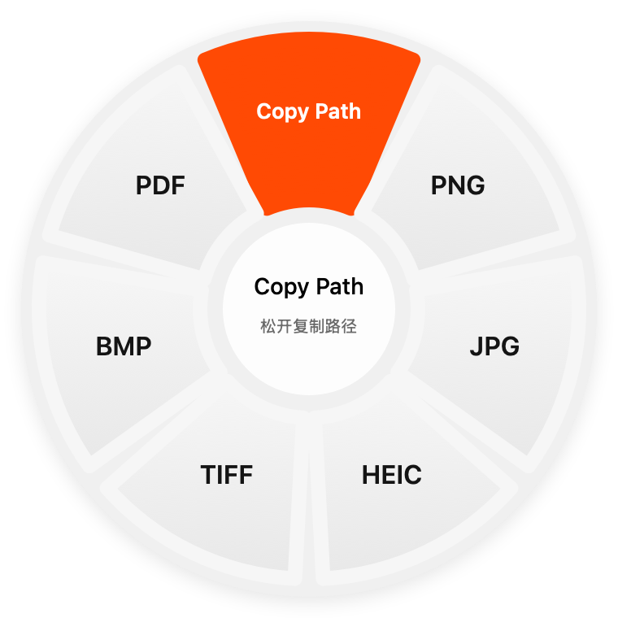

# 轻转 · QingZhuan

一个原生 macOS 文件格式转换工具。拖动文件，轻按 Shift，在圆形菜单选择目标格式后松开；也可以选择顶部的 **Copy Path** 复制完整路径。所有转换在本机完成，不上传文件。



## 下载与使用

在 [Releases](https://github.com/YYyp99/qingzhuan-mac/releases/latest) 下载 `QingZhuan-v0.3.4-arm64.zip`。解压后只有「轻转.app」，可拖入「应用程序」文件夹并双击运行。

- 适用：Apple Silicon Mac（M 系列），macOS 13 或更新系统。目前已在开发机验证，未提供 Intel 版本。
- 在 Finder 拖动文件时轻按 Shift，拖到目标格式后松开。
- Copy Path 固定在正上方；多选时一次复制所有完整路径，每个路径一行。
- 默认在原文件同级生成结果，保留文件名。例如 `照片.png` → `照片.jpg`。已有同名文件时自动编号，原文件不会被覆盖。
- 可以在主窗口选择文件转换，或指定其他保存位置。
- 完成后保持静默，不自动弹主窗口、不发送通知、不显示菜单栏状态文字。结果和错误可手动打开主窗口查看。

当前应用使用本地临时签名，**未经过 Apple 公证**。macOS 可能阻止首次打开；请仅在确认来源和校验值后，按系统提示或从「系统设置 → 隐私与安全性」处理。

## 支持范围

| 文件类型 | 可执行的操作 |
| --- | --- |
| 图片（PNG、JPEG、HEIC、WebP、TIFF、BMP、GIF 等，视系统解码能力） | 转 PNG、JPG、HEIC、TIFF、BMP、PDF；可选格式按系统编码能力和所选文件显示 |
| TXT、RTF、HTML、DOCX、DOC、ODT | 基础文档转换，或生成正文基础排版的 PDF |
| PDF | 逐页导出 PNG/JPG，或提取文字为 TXT/DOCX |
| 其他文件 | Copy Path |

WebP 当前仅支持读入，没有 WebP 输出项。文档转换不保证复杂表格、图片、页面布局的还原；PDF 转 Word 为文字提取，不是版式还原。扫描件不支持 OCR；多帧图片转单张图片会明确报错，转 PDF 则保留各帧。

## 本地构建

需要 macOS 和 Xcode 命令行工具；不依赖第三方转换库或网络服务。使用 AppKit、ImageIO、PDFKit、CoreText 和系统 `textutil`。

```sh
bash scripts/build.sh
```

生成 `build/轻转.app` 和 `build/QingZhuan-v0.3.4-arm64.zip`。脚本使用临时签名，输出不会自动安装或运行。

## 验证

```sh
bash scripts/test.sh
```

覆盖真实文件格式、中文内容、文件名保留、同名编号、原文件保护、PDF 分页、批量错误处理等 42 项检查。测试会在 `build/` 中生成独立样本；HEIC 编码需在可访问 macOS 图像服务的本机环境中运行。

此项目的交互灵感来自 [Tangerine](https://tangerineformac.com/)，本仓库为独立实现，与其无隶属关系。
